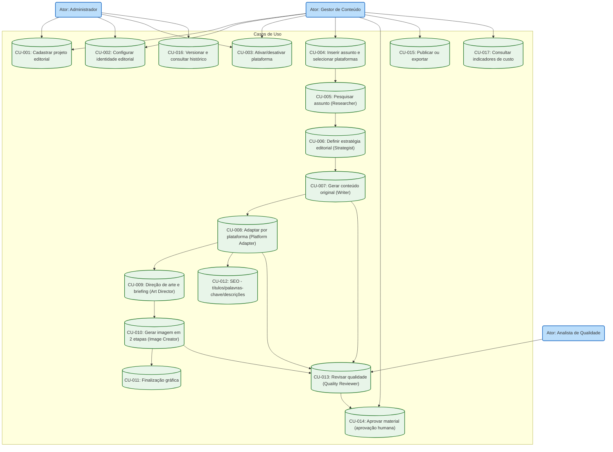
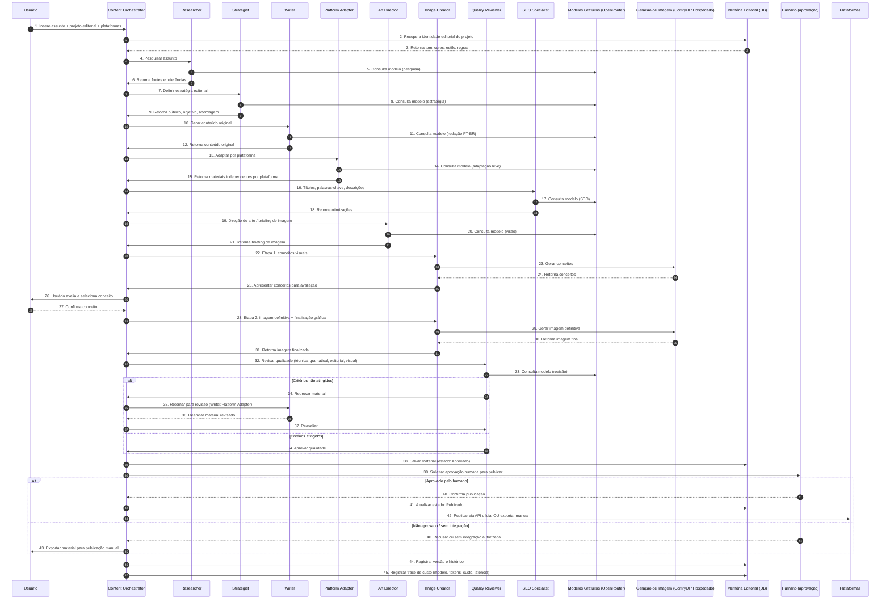
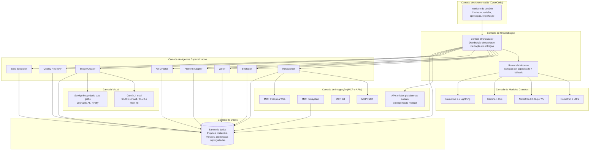
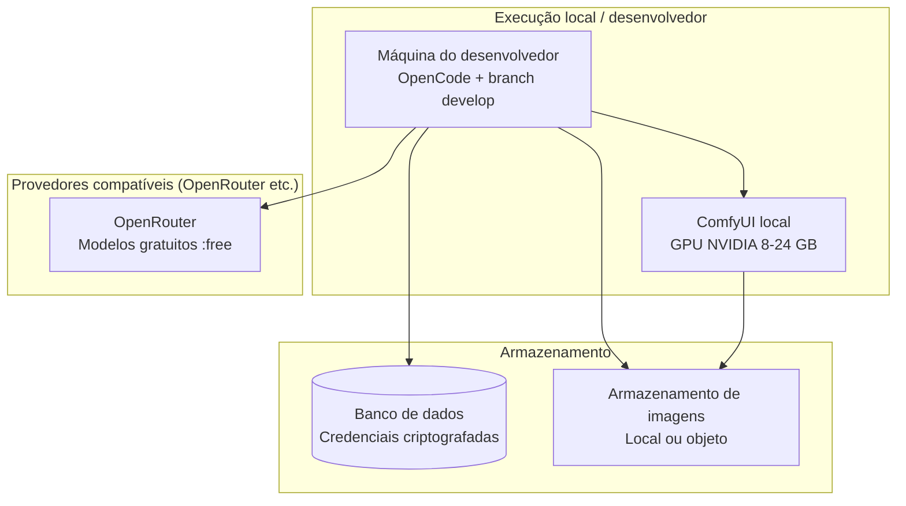

# Arquitetura e UML — Social Content Hub

> **Projeto:** Social Content Hub  
> **Integrado a:** OpenCode  
> **Etapa:** FASE 4 — Arquitetura e UML (planejamento, sem implementação)  
> **Versão:** 0.1  
> **Data:** 17/11/2026  
> **Branch:** `DOC`  
> **Notação:** Todos os diagramas em Mermaid (compatível GitHub/OpenCode). Sem imagens binárias.

---

## 1. Visão Geral da Arquitetura

O Social Content Hub opera como uma camada de orquestração sobre o OpenCode. O usuário insere um assunto e seleciona um projeto editorial; o **Content Orchestrator** distribui tarefas para agentes especializados; cada agente utiliza um modelo gratuito apropriado à sua responsabilidade e, quando necessário, servidores MCP (pesquisa, arquivos, Git) e ferramentas de geração de imagem. Os materiais passam por revisão de qualidade e exigem aprovação humana antes de atingir o estado "Publicado" ou serem exportados para publicação manual.

```mermaid
graph TD
    subgraph Usuario
        U[Usuário / Gestor de Conteúdo]
    end

    subgraph OpenCode["OpenCode (camada de orquestração)"]
        CO[Content Orchestrator<br/>Orquestrador central]
        R[Researcher<br/>Pesquisa]
        S[Strategist<br/>Estratégia editorial]
        W[Writer<br/>Redação]
        PA[Platform Adapter<br/>Adaptação por plataforma]
        AD[Art Director<br/>Direção de arte]
        IC[Image Creator<br/>Geração/edição de imagem]
        QR[Quality Reviewer<br/>Revisão de qualidade]
        SEO[SEO Specialist<br/>Otimização]
    end

    subgraph Modelos["Modelos gratuitos (OpenRouter / provedores compatíveis)"]
        M1[Nemotron 3 Ultra<br/>Orquestração/raciocínio]
        M2[Nemotron 3.5 Super VL<br/>Visão + pesquisa]
        M3[Gemma 4 31B<br/>Redação PT-BR / SEO]
        M4[Nemotron 3.5 Lightning<br/>Adaptação leve]
    end

    subgraph MCP["Servidores MCP"]
        MCPF[Fetch<br/>Consulta de páginas]
        MCPFS[Filesystem<br/>Arquivos]
        MCPG[Git<br/>Repositórios locais]
        MCPS[Pesquisa web<br/>Tavily/Exa/Perplexity/Brave]
    end

    subgraph Visual["Geração e edição de imagens"]
        CUI[ComfyUI local<br/>FLUX.1 schnell / FLUX.2 klein 4B]
        HOST[Serviço hospedado cota grátis<br/>Leonardo AI / Firefly / fallback]
    end

    subgraph Armazenamento["Memória editorial e histórico"]
        DB[(Banco de dados<br/>Projetos, materiais, versões, credenciais criptografadas)]
    end

    subgraph Plataformas["Plataformas digitais (ativáveis/desativáveis)"]
        L[LinkedIn]
        RD[Reddit]
        FB[Facebook]
        IG[Instagram]
        YT[YouTube]
        TT[TikTok]
        X[X / Twitter]
    end

    U -->|1. Insere assunto + projeto| CO
    CO -->|2. Distribui tarefas| R & S & W & PA & AD & IC & QR & SEO
    R -->|usa| MCPF & MCPS
    S -->|usa| M1
    W -->|usa| M3
    PA -->|usa| M4
    AD -->|usa| M2
    IC -->|usa| CUI & HOST
    QR -->|usa| M1
    SEO -->|usa| M3

    CO -->|3. Salva material| DB
    DB -->|4. Projetos / identidade / histórico| CO

    IC -->|5. Imagem gerada| DB
    QR -->|6. Aprovação / revisão| CO
    CO -->|7. Material aprovado| U
    U -->|8. Aprovação humana| CO
    CO -->|9. Publicar ou exportar| L & RD & FB & IG & YT & TT & X
    CO -->|10. Exportação manual| U

    style CO fill:#FFE4B5
    style DB fill:#E1F5FE
    style CUI fill:#C8E6C9
    style HOST fill:#FFF9C4
```



---

## 2. Diagrama de Casos de Uso



---

## 3. Diagrama de Classes / Entidade-Relacionamento

```mermaid
classDiagram
    class ProjetoEditorial {
        +String id
        +String nome
        +String objetivo
        +String publicoAlvo
        +String tomVoz
        +List~String~ paletaCores
        +String estiloImagens
        +List~String~ regrasRedacao
        +List~Plataforma~ plataformas
        +List~SerieEditorial~ series
        +List~Referencia~ referencias
        +DateTime criadoEm
        +DateTime atualizadoEm
        +criar()
        +atualizar()
        +listar()
    }

    class Plataforma {
        +String id
        +String nome
        +Boolean ativo
        +Integer limiteCaracteres
        +List~String~ hashtags
        +String proporcaoImagem
        +EstruturaEditorial estrutura
        +configurarRegras()
    }

    class Material {
        +String id
        +String projetoId
        +String assunto
        +EstadoPublicacao estado
        +String conteudoOriginal
        +Map~String, String~ conteudoPorPlataforma
        +String imagemId
        +String briefingImagem
        +List~String~ palavrasChave
        +String titulo
        +String descricao
        +DateTime criadoEm
        +DateTime aprovadoEm
        +DateTime publicadoEm
        +String aprovadoPor
        +submeterRevisao()
        +aprovar(usuario)
        +publicar()
        +exportar()
    }

    class Imagem {
        +String id
        +String materialId
        +String conceitoVisual
        +String estiloArtistico
        +String composicao
        +String iluminacao
        +String paletaCromatica
        +List~String~ elementosVisuais
        +String formato
        +String proporcao
        +String caminhoArquivo
        +Integer resolucaoLargura
        +Integer resolucaoAltura
        +Boolean conceitoAvaliado
        +gerarEtapa1()
        +gerarEtapa2()
        +finalizarGrafica()
    }

    class RastreabilidadeCusto {
        +String id
        +String materialId
        +String modeloUsado
        +Integer tokensEntrada
        +Integer tokensSaida
        +Float custo
        +Float latenciaMs
        +DateTime timestamp
        +registrarTrace()
    }

    class CredencialPlataforma {
        +String id
        +String plataforma
        +String valorCriptografado
        +DateTime atualizadoEm
    }

    ProjetoEditorial "1" -- "*" Plataforma : utiliza
    ProjetoEditorial "1" -- "*" Material : gera
    Material "1" -- "0..1" Imagem : possui
    Material "1" -- "*" RastreabilidadeCusto : registra
    Plataforma "1" -- "1" CredencialPlataforma : autentica

    class ProjetoEditorial domain:#E3F2FD;
    class Material domain:#FFF3E0;
    class Imagem domain:#E8F5E9;
    class RastreabilidadeCusto domain:#F3E5F5;
    class CredencialPlataforma domain:#FFEBEE;
```

---

## 4. Diagrama de Sequência — Fluxo Principal

Fluxo completo: do assunto à publicação/exportação, com revisão de qualidade e aprovação humana.



---

## 5. Diagrama de Componentes



---

## 6. Diagrama de Implantação (Deploy) — Opcional



---

## 7. Decisões de Arquitetura (ADRs)

As decisões estão documentadas em `docs/social-content-hub/04-ADRs/`:

| ADR | Título | Status |
|-----|--------|--------|
| ADR-001 | Uso exclusivo de modelos gratuitos (OpenRouter); proibição de API paga da OpenAI | Aceito |
| ADR-002 | Geração de imagens: ComfyUI local + FLUX.1 [schnell] / FLUX.2 [klein] 4B; hospedado como fallback | Aceito |
| ADR-003 | Servidores MCP: Filesystem, Fetch, Git (referência oficial); pesquisa web via servidores oficiais de fornecedor; publicação social via MCP próprio ou API direta | Aceito |
| ADR-004 | Arquitetura multiagente com orquestrador central; agentes agrupados por responsabilidade, sem redundância | Aceito |
| ADR-005 | Estados de publicação Rascunho/Aprovado/Publicado; aprovação humana obrigatória; exportação para publicação manual | Aceito |

---

## 8. Validação de Consistência (UML ↔ SRS)

| RF | Caso de Uso | Entidade/Classe | Sequência | Diagrama de Classes |
|----|-------------|-----------------|-----------|---------------------|
| RF-001 | CU-001 | ProjetoEditorial | Passo 2 | ✅ |
| RF-002 | CU-002 | ProjetoEditorial | Passo 2-3 | ✅ |
| RF-003 | CU-003 | Plataforma | — | ✅ |
| RF-004 | CU-004 | Material | Passo 1 | ✅ |
| RF-005 | CU-005 | — | Passo 4-6 | — |
| RF-006 | CU-006 | — | Passo 7-9 | — |
| RF-007 | CU-007 | Material | Passo 10-12 | ✅ |
| RF-008 | CU-008 | Material | Passo 13-15 | ✅ |
| RF-009 | CU-009 | Imagem | Passo 19-21 | ✅ |
| RF-010 | CU-010 | Imagem | Passo 22-31 | ✅ |
| RF-011 | CU-011 | Imagem | Passo 28-31 | ✅ |
| RF-012 | CU-012 | Material | Passo 16-18 | ✅ |
| RF-013 | CU-013 | Material | Passo 32-37 | ✅ |
| RF-014 | CU-014 | Material | Passo 39-43 | ✅ |
| RF-015 | CU-015 | Material | Passo 43 | ✅ |
| RF-016 | CU-016 | ProjetoEditorial / Material | Passo 44 | ✅ |
| RF-017 | CU-017 | RastreabilidadeCusto | Passo 45 | ✅ |
| RF-018 | — | RastreabilidadeCusto | Passo 45 | ✅ |

Todo RF possui caso de uso correspondente. Toda entidade tem dono definido. Nenhum agente redundante identificado.

---

## 9. Riscos Arquiteturais

| Risco | Impacto | Probabilidade | Mitigação |
|-------|---------|---------------|-----------|
| Acoplamento a um único provedor de modelos | Alto | Média | Router de modelos com fallback; abstração por capacidade |
| Limite de taxa dos modelos gratuitos | Alto | Alta | Cache semântico, agrupamento de chamadas, reserva de modelos pesados |
| Nenhum MCP pronto para publicação social | Médio | Alta | Desenvolver MCP próprio sobre APIs oficiais ou exportação manual |
| Hardware insuficiente para geração de imagem local | Médio | Média | Fallback para serviço hospedado com cota gratuita |
| Credenciais expostas | Alto | Baixa | Criptografia (AES-256), escopo mínimo, rate-limit nos MCP |

---

*Próxima etapa: FASE 5 — Scrum / Backlog e rotina de prototipação de telas.*
