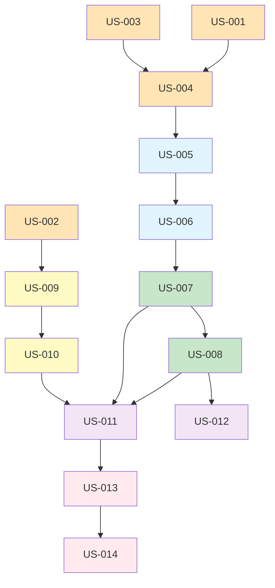

# SCRUM — Backlog do Projeto Social Content Hub

> **Projeto:** Social Content Hub  
> **Integrado a:** OpenCode  
> **Etapa:** FASE 5 — Planejamento de execução (sem implementação)  
> **Versão:** 0.1  
> **Data:** 17/11/2026  
> **Branch:** `DOC`  
> **Template base:** `docs/templates/SCRUM_TEMPLATE.md`

---

## 1. Backlog Inicial

### 1.1 Épicos

| Épico | Descrição | Prioridade |
|-------|-----------|------------|
| EPIC-001 | Memória editorial: cadastro e configuração de projetos editoriais (objetivo, público, tom, identidade visual, plataformas, séries) | Alta |
| EPIC-002 | Orquestração multiagente: Content Orchestrator + agentes especializados (Researcher, Strategist, Writer, Platform Adapter, Art Director, Image Creator, Quality Reviewer, SEO Specialist) | Alta |
| EPIC-003 | Geração de conteúdo por assunto com adaptação por plataforma (LinkedIn, Reddit, Facebook, Instagram, YouTube, TikTok, X/Twitter) | Alta |
| EPIC-004 | Geração de imagens em duas etapas (conceito → definitiva) com direção de arte e finalização gráfica | Alta |
| EPIC-005 | Controle de qualidade: revisão, critérios objetivos de aprovação, fluxo de retorno para revisão | Alta |
| EPIC-006 | Estados de publicação (Rascunho/Aprovado/Publicado), aprovação humana, exportação para publicação manual | Alta |
| EPIC-007 | Memória e histórico: versionamento de materiais, rastreabilidade, indicadores de custo por publicação/projeto | Média |
| EPIC-008 | Integrações MCP: Filesystem, Fetch, Git, pesquisa web; desenvolvimento de MCP próprio para publicação social quando necessário | Média |
| EPIC-009 | Controle de custos: limites de uso, cache semântico, router de modelos com fallback, evitando chamadas desnecessárias | Média |
| EPIC-010 | Documentação e governança: SRS, UML, ADRs, plano de testes, roadmap, critérios de aceitação | Alta |

---

### 1.2 User Stories

**Formato: Como [tipo de usuário] quero [funcionalidade] para [objetivo]**

| ID | User Story | Critérios de Aceitação | Épico | Estimativa (pts) | Sprint Sugerida |
|----|------------|------------------------|-------|------------------|-----------------|
| US-001 | Como Administrador quero cadastrar um projeto editorial com nome, objetivo, público-alvo, tom de voz e plataformas | - Formulário de cadastro funciona - Campos obrigatórios validados - Projeto listado após criação | EPIC-001 | 3 | Sprint 1 |
| US-002 | Como Administrador quero configurar identidade editorial (paleta, estilo de imagens, regras de redação) por projeto | - Paleta de cores salva - Estilo de imagens definido - Regras de redação associadas ao projeto | EPIC-001 | 3 | Sprint 1 |
| US-003 | Como Administrador quero ativar e desativar plataformas individualmente | - Cada plataforma pode ser ligada/desligada - Plataforma desativada não aparece na geração | EPIC-001 | 2 | Sprint 1 |
| US-004 | Como Gestor de Conteúdo quero inserir um assunto e selecionar o projeto e as plataformas alvo | - Campo de assunto aceito - Projeto e plataformas selecionados - Fluxo de geração iniciado | EPIC-003 | 3 | Sprint 2 |
| US-005 | Como Researcher (agente) quero pesquisar o assunto, fontes e referências relevantes | - Pesquisa executada via MCP Fetch/Tavily/Exa - Fontes listadas com URL - Referências armazenadas no projeto | EPIC-002 | 5 | Sprint 2 |
| US-006 | Como Strategist (agente) quero definir público, objetivo, abordagem e estratégia editorial | - Estratégia documentada - Alinhada ao tom de voz do projeto - Aprovada pelo orquestrador | EPIC-002 | 5 | Sprint 2 |
| US-007 | Como Writer (agente) quero produzir conteúdo original em português brasileiro com profundidade adequada | - Texto original gerado - Respeita regras de redação do projeto - Qualidade textual adequada | EPIC-003 | 5 | Sprint 3 |
| US-008 | Como Platform Adapter (agente) quero adaptar o conteúdo para cada plataforma (limite de caracteres, hashtags, proporções) | - Material independente por plataforma - Não há cópia idêntica entre canais - Limite de caracteres respeitado | EPIC-003 | 5 | Sprint 3 |
| US-009 | Como Art Director (agente) quero definir o briefing de imagem (conceito, estilo, composição, iluminação, paleta, proporção) | - Briefing de imagem gerado - Coerente com identidade editorial - Proporção definida por plataforma | EPIC-004 | 5 | Sprint 3 |
| US-010 | Como Image Creator (agente + ferramenta) quero gerar a imagem em duas etapas (conceito → definitiva) | - Etapa 1: conceitos apresentados para avaliação - Etapa 2: imagem definitiva gerada após seleção - Não há gerações extras sem critério | EPIC-004 | 8 | Sprint 3 |
| US-011 | Como Quality Reviewer (agente) quero avaliar qualidade técnica, gramatical, editorial e visual contra critérios objetivos | - Critérios de qualidade verificados - Material aprovado ou retornado para revisão - Resultado da avaliação registrado | EPIC-005 | 5 | Sprint 4 |
| US-012 | Como SEO Specialist (agente) quero trabalhar títulos, palavras-chave e descrições por plataforma | - Títulos otimizados - Palavras-chave definidas - Descrições por plataforma | EPIC-003 | 3 | Sprint 4 |
| US-013 | Como Gestor de Conteúdo quero aprovar ou rejeitar um material antes da publicação | - Aprovação humana registrada - Material rejeitado retorna para revisão - Material aprovado avança para "Publicado" | EPIC-006 | 3 | Sprint 4 |
| US-014 | Como Gestor de Conteúdo quero exportar o material final para publicação manual quando não houver integração autorizada | - Exportação funcionando - Material completo (texto + imagem + metadados) - Instruções de publicação incluídas | EPIC-006 | 3 | Sprint 4 |
| US-015 | Como Administrador quero consultar o histórico e versões dos materiais de um projeto | - Histórico listado - Versões acessíveis - Continuidade entre séries preservada | EPIC-007 | 3 | Sprint 5 |
| US-016 | Como Administrador quero consultar indicadores de custo por publicação e por projeto | - Custo por modelo exibido - Custo por publicação calculado - Custo por projeto agregado | EPIC-007 | 3 | Sprint 5 |
| US-017 | Como Sistema quero aplicar limites de uso e evitar chamadas desnecessárias a modelos | - Cache semântico ativo - Router de modelos com fallback - Chamadas desnecessárias bloqueadas | EPIC-009 | 5 | Sprint 5 |
| US-018 | Como Desenvolvedor quero dispor de SRS, UML, ADRs e plano de testes aprovados antes de iniciar implementação | - Documentos de planejamento entregues - Critérios de aceitação definidos - DoR e DoD estabelecidos | EPIC-010 | 5 | Sprint 0 |

---

### 1.3 Sprints Sugeridas (Velocidade Inicial: 8 pts/sprint)

#### Sprint 0 - Fundação e Planejamento (2 semanas)
- **Objetivo:** Entregar toda a documentação de planejamento (SRS, UML, ADRs, backlog, plano de testes) e obter aprovação dos stakeholders.
- **US:** US-018
- **Deliveráveis:**
  - SRS aprovado
  - Diagramas UML (Mermaid)
  - ADRs (ADR-001 a ADR-005)
  - Backlog Scrum e roadmap
  - Plano de testes
- **Riscos:** Escopo de planejamento subestimado; falta de validação de benchmarks com testes práticos.

#### Sprint 1 - Memória Editorial e Configuração (2 semanas)
- **Objetivo:** Implementar cadastro de projetos editoriais, identidade editorial e ativação/desativação de plataformas.
- **US:** US-001, US-002, US-003
- **Deliveráveis:**
  - CRUD de projetos editoriais
  - Configuração de identidade editorial (tom, cores, estilo, regras)
  - Toggle de plataformas (LinkedIn, Reddit, Facebook, Instagram, YouTube, TikTok, X/Twitter)
- **Riscos:** Definição de campos de identidade editorial pode mudar com feedback do usuário.

#### Sprint 2 - Pesquisa e Estratégia (2 semanas)
- **Objetivo:** Implementar fluxo de entrada de assunto, pesquisa (Researcher) e definição de estratégia (Strategist).
- **US:** US-004, US-005, US-006
- **Deliveráveis:**
  - Tela de entrada de assunto e seleção de projeto/plataformas
  - Integração com MCP Fetch e servidor de pesquisa web
  - Geração de estratégia editorial documentada
- **Riscos:** Limite de taxa de modelos gratuitos; dependência de chaves de API de pesquisa web.

#### Sprint 3 - Redação, Adaptação e Imagens (3 semanas)
- **Objetivo:** Implementar geração de conteúdo (Writer), adaptação por plataforma (Platform Adapter), direção de arte (Art Director) e geração de imagem em duas etapas (Image Creator).
- **US:** US-007, US-008, US-009, US-010
- **Deliveráveis:**
  - Conteúdo original em PT-BR
  - Materiais independentes por plataforma
  - Briefing de imagem e geração via ComfyUI + FLUX (ou fallback hospedado)
  - Finalização gráfica
- **Riscos:** Qualidade visual premium exige iteração; GPU insuficiente para ComfyUI local; limites de cota de imagem hospedada.

#### Sprint 4 - Qualidade, SEO e Publicação (2 semanas)
- **Objetivo:** Implementar revisão de qualidade (Quality Reviewer), SEO, estados de publicação, aprovação humana e exportação manual.
- **US:** US-011, US-012, US-013, US-014
- **Deliveráveis:**
  - Revisão de qualidade com critérios objetivos
  - Títulos, palavras-chave, descrições por plataforma
  - Estados Rascunho/Aprovado/Publicado
  - Aprovação humana e exportação para publicação manual
- **Riscos:** Aprovação humana é gargalo; APIs oficiais de plataformas podem restringir publicação automática.

#### Sprint 5 - Memória, Custos e MCP (2 semanas)
- **Objetivo:** Implementar versionamento/histórico, indicadores de custo, limites de uso e integrações MCP (Filesystem, Fetch, Git).
- **US:** US-015, US-016, US-017, US-018 (parte de integrações)
- **Deliveráveis:**
  - Histórico e versões de materiais
  - Dashboard de custos por publicação/projeto
  - Cache semântico e router de modelos com fallback
  - MCP Filesystem, Fetch, Git integrados
- **Riscos:** Armazenamento de credenciais criptografadas (LGPD); desenvolvimento de MCP próprio para publicação social pode ser adiado.

---

## 2. Mapa de Telas × Sprint

| Tela | Status | Sprint Aprovação | Sprint Implementação | Protótipo |
|------|--------|------------------|----------------------|-----------|
| Tela 1 - Cadastro de projeto editorial | PROPOSTA | Sprint 1 | Sprint 1 | ❌ |
| Tela 2 - Configuração de identidade editorial | PROPOSTA | Sprint 1 | Sprint 1 | ❌ |
| Tela 3 - Ativação/desativação de plataformas | PROPOSTA | Sprint 1 | Sprint 1 | ❌ |
| Tela 4 - Entrada de assunto e seleção de plataformas | PROPOSTA | Sprint 2 | Sprint 2 | ❌ |
| Tela 5 - Revisão e aprovação de material | PROPOSTA | Sprint 4 | Sprint 4 | ❌ |
| Tela 6 - Exportação para publicação manual | PROPOSTA | Sprint 4 | Sprint 4 | ❌ |
| Tela 7 - Histórico e versões do projeto | PROPOSTA | Sprint 5 | Sprint 5 | ❌ |
| Tela 8 - Indicadores de custo | PROPOSTA | Sprint 5 | Sprint 5 | ❌ |

> Regra dura: nenhuma tela avança para implementação sem protótipo APROVADO (dono `@protomaster`). O status acima será atualizado à medida que os protótipos passarem por PROPOSTA → NAVEGÁVEL → VALIDADA → APROVADA.

---

## 3. Plano de Testes por História

| US | Tipo de Teste | Ferramenta Sugerida | Cobertura |
|----|--------------|---------------------|-----------|
| US-001 | Funcional | Jest / Vitest | 100% |
| US-002 | Funcional | Jest / Vitest | 100% |
| US-003 | Funcional | Jest / Vitest | 100% |
| US-004 | Funcional | Jest / Vitest | 100% |
| US-005 | Integração (MCP) | Playwright / testes de MCP | 90% |
| US-006 | Funcional | Jest / Vitest | 90% |
| US-007 | Funcional + Qualidade | Testes de geração de texto | 85% |
| US-008 | Funcional | Testes de adaptação por plataforma | 90% |
| US-009 | Funcional | Revisão de briefing de imagem | 80% |
| US-010 | Funcional (imagem) | Testes de geração de imagem | 80% |
| US-011 | Funcional (revisão) | Testes de critérios de qualidade | 90% |
| US-012 | Funcional | Testes de SEO | 85% |
| US-013 | Funcional (aprovação humana) | Testes de fluxo de aprovação | 100% |
| US-014 | Funcional (exportação) | Testes de exportação | 90% |
| US-015 | Funcional | Testes de histórico/versão | 90% |
| US-016 | Não-funcional (custo) | Testes de cálculo de custo | 90% |
| US-017 | Não-funcional (limites) | Testes de cache e router | 90% |
| US-018 | Documentação | Revisão de planejamento | 100% |

---

## 4. Checklist Anti-Retrabalho

- [ ] Protótipo APROVADO antes de iniciar implementação de qualquer tela
- [ ] SRS validado por stakeholders
- [ ] ADRs documentados (ADR-001 a ADR-005)
- [ ] DevLog configurado (entrada obrigatória no DoD de cada US)
- [ ] Estratégia de branches definida (develop → feature/* → PR → develop → release/* → main)
- [ ] Critérios de aceite em Gherkin definidos para cada RF
- [ ] Matriz de rastreabilidade RF × RN × Testes preenchida
- [ ] Benchmarks validados com testes práticos (modelos gratuitos e geração de imagem)

---

## 5. Métricas de Progresso

| Sprint | Completo | Em andamento | Bloqueado | Total |
|--------|----------|--------------|-----------|-------|
| Sprint 0 | 0 | 0 | 0 | 1 |
| Sprint 1 | 0 | 0 | 0 | 3 |
| Sprint 2 | 0 | 0 | 0 | 3 |
| Sprint 3 | 0 | 0 | 0 | 4 |
| Sprint 4 | 0 | 0 | 0 | 4 |
| Sprint 5 | 0 | 0 | 0 | 4 |

---

## 6. Dependências entre User Stories

---

## 7. Próximos Passos (após aprovação do planejamento)

1. Aprovação do SRS, UML, ADRs e backlog pelos stakeholders.
2. Criação de issues e milestones no GitHub/GitLab correspondentes aos épicos e sprints.
3. Setup do ambiente de desenvolvimento na branch `develop`.
4. Início da Sprint 0 (validação de planejamento) e Sprint 1 (memória editorial).
5. Primeira entrada no `docs/dev-log.md` com o despacho de planejamento.

---

*Próxima etapa: FASE 6 — Plano de entrega + dev-log.*
